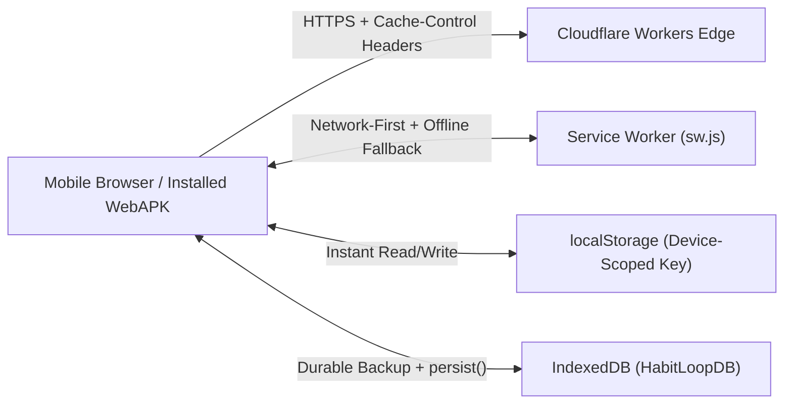

# FLEE
<div align="center">


# FLEE

**An offline-first, privacy-focused Progressive Web App (PWA) for building daily habits and breaking unwanted routines.**

[](https://habit-loop.nkentekhiwe.workers.dev)
[](https://habit-loop.nkentekhiwe.workers.dev)
[](#architecture)
[](LICENSE)

[**Open Live App →**](https://habit-loop.nkentekhiwe.workers.dev)

</div>

---

## Overview

**FLEE** is a mobile-first habit and behavioral-change tracker engineered to feel like a native iOS/Android app while running with zero framework bloat or build tooling. It combines **cue-routine habit loops** with **evidence-based recovery mechanics**—so users build momentum on positive habits and resist urges on habits they want to break.

### Key Features

- **Dual Habit Modes (`Build` & `Break`)**
  - **Build:** Track daily completions, active streaks, 7-day momentum grids, and progress rings (`0%–100%`).
  - **Break:** Track clean-day streaks, lifetime clean days banked, urges resisted, and **monthly Grace Slips** (*"Never miss twice"* recovery without losing lifetime progress).
- **90-Second SOS Breathing Anchor:** Guided `Inhale → Hold → Exhale → Hold` breathing timer with smooth CSS scale transitions to surf cravings in real time.
- **Trigger & Slip Analytics:** Logs slip triggers (`Stress`, `Boredom`, `Social`, `Tired`, `Autopilot`) and surfaces the user's top trigger patterns in **Insights**.
- **14-Week Activity Matrix & Milestones:** GitHub-style 98-day heatmap plus milestone progression (`21`, `30`, `50`, `100` days) and a 6-week SVG sparkline.
- **Inline Habit Editing & JSON Export:** Tap any habit to update its name, category, cue-routine trigger (`When I... → I will...`), or target milestone, or export full history as JSON.

---

## Architecture & Engineering Highlights

FLEE was intentionally built with **zero runtime dependencies and zero bundler overhead** to maximize load speed on mobile networks and ensure full offline reliability:



### Technical Decisions

1. **Per-Device Privacy Isolation:**
   - Each device generates a persistent `habitloop_device_id_v1` stored across `localStorage` and `IndexedDB`.
   - Default Member sessions are strictly isolated per device (`@device.local`) so multiple people using the same public URL never share or overwrite each other's habits or streaks.
2. **Dual-Layer Client Persistence (`localStorage` + `IndexedDB`):**
   - Calls `navigator.storage.persist()` on startup to request durable browser storage.
   - Mirrors every state mutation to both `localStorage` and an `IndexedDB` object store (`HabitLoopDB`) with automatic recovery on launch.
3. **Zero-Stale Service Worker Lifecycle (`sw.js`):**
   - Uses a **network-first with cache fallback** fetch strategy so online users always receive fresh updates while offline users seamlessly fall back to cached assets.
   - Listens for `controllerchange` in the client and sets `updateViaCache: 'none'` + explicit `_headers` so installed PWAs hot-reload automatically after deployments.
4. **Native Android & iOS Installability:**
   - Captures `beforeinstallprompt` for a one-tap native Android WebAPK install flow alongside `apple-mobile-web-app-capable` metadata and 192×192 / 512×512 maskable PNG icons.
5. **Automated Edge CI/CD:**
   - Configured with `wrangler.jsonc` and GitHub Actions (`.github/workflows/deploy.yml`) to deploy static assets globally to Cloudflare Workers on every push to `main`.

---

## Project Structure

```text
.
├── index.html                   # Single-file SPA (UI, state engine, IndexedDB/localStorage sync, SVG icons)
├── manifest.json                # Web App Manifest (standalone display, maskable PNG icons, scope)
├── sw.js                        # Service Worker (network-first + offline cache fallback)
├── _headers                     # Cloudflare edge cache-control & Service-Worker-Allowed headers
├── wrangler.jsonc               # Cloudflare Workers static asset deployment config
├── icon-192.png                 # 192x192 app & maskable icon
├── icon-512.png                 # 512x512 app & maskable icon
├── .github/workflows/deploy.yml # Automated CI/CD deployment to Cloudflare Workers
└── LICENSE                      # MIT License
```

---

## Local Development & Deployment

### Run Locally
Serve the directory with any static HTTP server:
```bash
python3 -m http.server 8080
```
Then open `http://localhost:8080` in your browser.

### Deploy to Cloudflare Workers
```bash
npx wrangler deploy --config wrangler.jsonc
```

---

## Future Roadmap

- Optional end-to-end encrypted cloud sync for multi-device backup using Web Crypto API (`AES-GCM`).
- Push notification reminders via Web Push API.
- Automated Playwright end-to-end test suite covering streak calculation across midnight/timezone boundaries.

---

<div align="center">
Built by <strong>Khiwe Nkente</strong>
</div>
